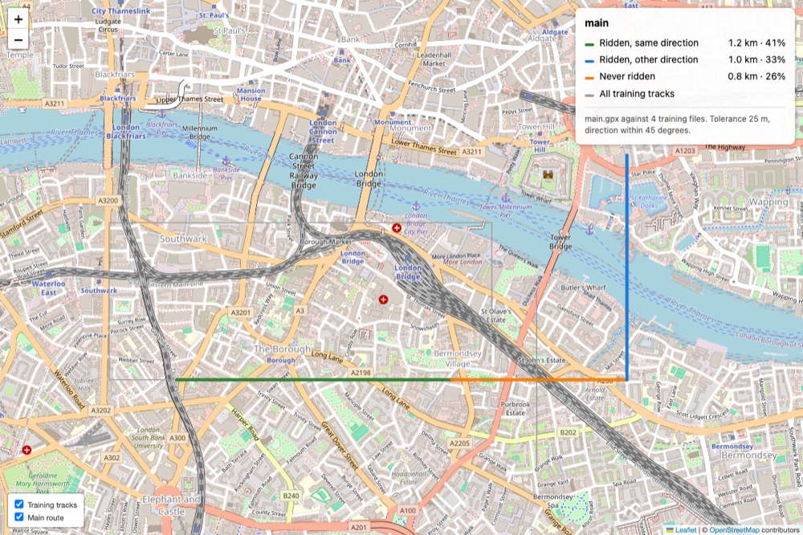

# geepeex

Tools for fetching GPX tracks and looking at them on a map. Each tool is a
subcommand of `gpx`.

| Command | What it does |
| --- | --- |
| `gpx strava` | Download matching Strava activities as GPX into `./gpx` |
| `gpx coverage` | Colour a route by whether you have ridden it in training, as a webpage |

## Requirements

Python 3.10 or newer, and [uv](https://docs.astral.sh/uv/). The only runtime
dependency is `requests`; the map pages pull Leaflet from a CDN when opened.

## Install

    uv sync --extra dev

Then run the CLI with `uv run gpx …`, or install it on your path with
`uv tool install .`.

## Quick start

    uv run gpx strava                                   # download some tracks
    uv run gpx coverage gpx/big-ride.gpx "gpx/*.gpx"    # see what you have ridden
    open coverage.html

---

## `gpx strava`

Strava has **no GPX endpoint**. The only route to a track is
`/activities/{id}/streams`, which returns parallel arrays (`latlng`,
`altitude`, `time`); geepeex reassembles those into trackpoints. The GPX is
therefore built by us, not exported by Strava, so it carries position,
elevation and timestamps but none of the sensor channels (heart rate, power,
cadence) unless we add them.

### One-time Strava app registration

1. Go to <https://www.strava.com/settings/api> and create an API application.
2. Set **Authorization Callback Domain** to `localhost`. Without this Strava
   rejects the redirect and the browser never comes back.
3. Run `gpx strava`. It prompts for the Client ID and Client Secret, opens a
   browser for consent, and stores the resulting refresh token in
   `~/.config/geepeex/strava.json` (mode 0600).

The requested scope is `activity:read_all`, so private activities are included.
Access tokens last six hours and are refreshed automatically; use
`gpx strava --reauth` to redo the browser step.

### Use

Interactive — lists the sport types actually present on the account, prompts
for keywords and types, prints the matches, then asks before downloading:

    gpx strava

Non-interactive:

    gpx strava -k commute,ferry -t Ride,VirtualRide -y
    gpx strava --after 2026-01-01 -t Run -o tracks -y

| Option | Meaning |
| --- | --- |
| `-k, --keywords` | Comma-separated name keywords |
| `-t, --types` | Comma-separated sport types, e.g. `Ride,Run` |
| `-o, --out` | Output folder (default `gpx`) |
| `--after`, `--before` | Limit to a date range, `YYYY-MM-DD` |
| `-y, --yes` | Skip the prompts and the confirmation |
| `--reauth` | Redo the browser authorisation |

Keywords are case-insensitive substrings matched against the activity **name**
only (the listing endpoint carries no description). Multiple keywords are OR;
keywords and types together are AND. A blank filter matches everything.

Files land in `./gpx` as `YYYY-MM-DD-slug-<id>.gpx`, using the *local* activity
date. Existing files are skipped, so an interrupted run resumes by re-running.

### Rate limits

Strava allows 100 requests per 15 minutes and 1000 per day. Listing costs one
request per 200 activities; each download costs one more. On a 429 the run
stops, reports how many were written, and tells you to re-run after the window
resets — already-downloaded files are skipped on the retry. Activities with no
`latlng` stream (trainer rides, pool swims) are reported and skipped rather
than written as empty tracks.

---

## `gpx coverage`

Colours a main route by whether you have ridden each part of it in training,
and writes a webpage showing it.

    gpx coverage route.gpx "gpx/*.gpx" -o coverage.html

- 🟢 **green** — ridden in the same direction as the route
- 🔵 **blue** — ridden, but only in the opposite direction
- 🟠 **orange** — never ridden
- ⬜ **light grey** — every training track, drawn underneath for context

*The example above is the synthetic route the tests use — a 2 km leg east and a
1 km leg north — not a real ride. It is there to show the four colours.*

Green wins wherever both directions were ridden: an out-and-back covers a road
twice, and the direction the route itself uses is the one worth reporting.

Training files may be given as already-expanded shell arguments or as a quoted
glob. The main route is dropped from the training set automatically, since a
glob like `gpx/*.gpx` usually contains it and would otherwise colour everything
green with nothing obviously wrong on the page.

The terminal gets the same numbers as the legend:

    Main route 3.0 km
      Ridden, same direction         1.2 km     41%
      Ridden, other direction        1.0 km     33%
      Never ridden                   0.8 km     26%

### Matching

The route is cut into segments of `--resolution` metres. A segment counts as
ridden if a training track passes within `--tolerance` metres **and** runs
within `--angle` degrees of parallel.

| Option | Default | Meaning |
| --- | --- | --- |
| `-o, --out` | `coverage.html` | Output file |
| `--tolerance` | 25 m | GPS slack when deciding a track is on the route |
| `--angle` | 45° | How far a pass may deviate and still count as the same direction |
| `--resolution` | 15 m | Metres per coloured segment |
| `--max-gap` | 200 m | Ignore training jumps longer than this |
| `--no-training-layer` | | Leave the grey tracks off the map |
| `--title` | main file name | Page title |

Three of these defaults exist to stop a plausible but wrong map, and are worth
understanding before changing them:

- **`--angle`** is what stops every road *crossing* the route from marking it as
  covered. Raise it towards 90 and junctions start counting as coverage.
- **`--max-gap`** discards the straight jump across a paused recording. Without
  it, a track that stopped on one side of town and resumed on the other paints
  coverage along every road on the line between.
- **`--resolution`** sets the colour granularity. A route recorded one point per
  200 m would otherwise be coloured in 200 m blocks whatever the tolerance.

Distances use a local equirectangular projection in metres; over the span of a
route the error is far below the GPS tolerance being worked to.

The page is Leaflet over OpenStreetMap tiles. Both layers can be toggled, and
the route always draws above the grey regardless of toggle order.

---

## Tests

    uv run --extra dev pytest

The network path to Strava is not covered — tests exercise the pure logic
(filtering, GPX construction, filename derivation, coverage classification and
page rendering) against literal fixtures.

## Layout

| File | |
| --- | --- |
| `geepeex/cli.py` | The `gpx` command and its subcommands |
| `geepeex/strava.py` | OAuth, activity listing, stream fetching, filtering |
| `geepeex/gpxfile.py` | Reading and writing GPX |
| `geepeex/coverage.py` | Deciding which parts of a route were ridden, and which way |
| `geepeex/mapview.py` | Rendering a coverage result as a Leaflet page |

`CLAUDE.md` records why things are the way they are, including the Strava
gotchas that cost time to find.
