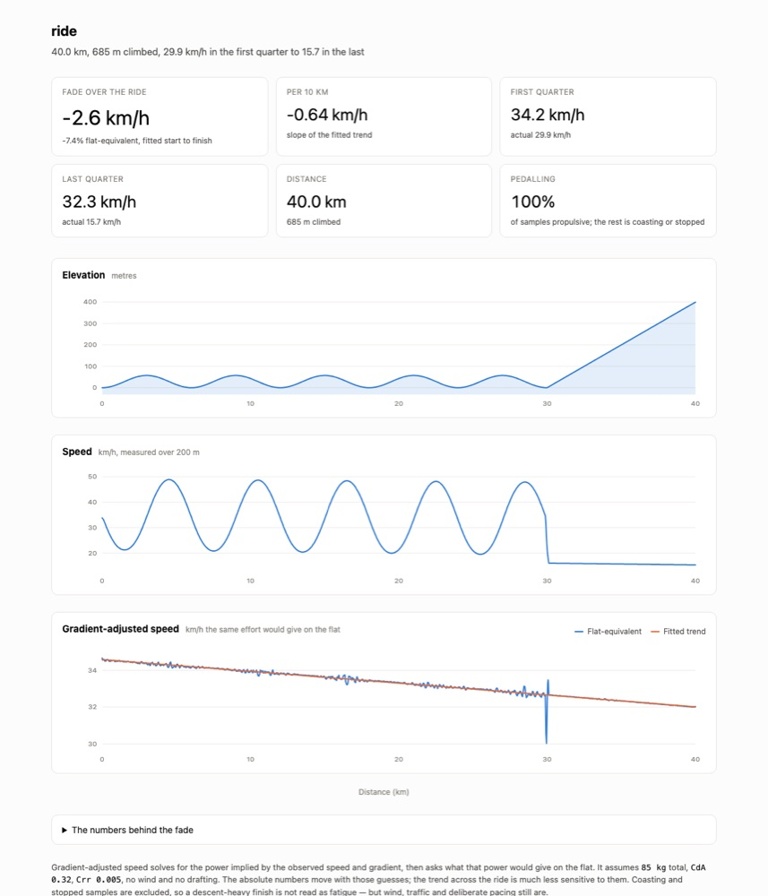
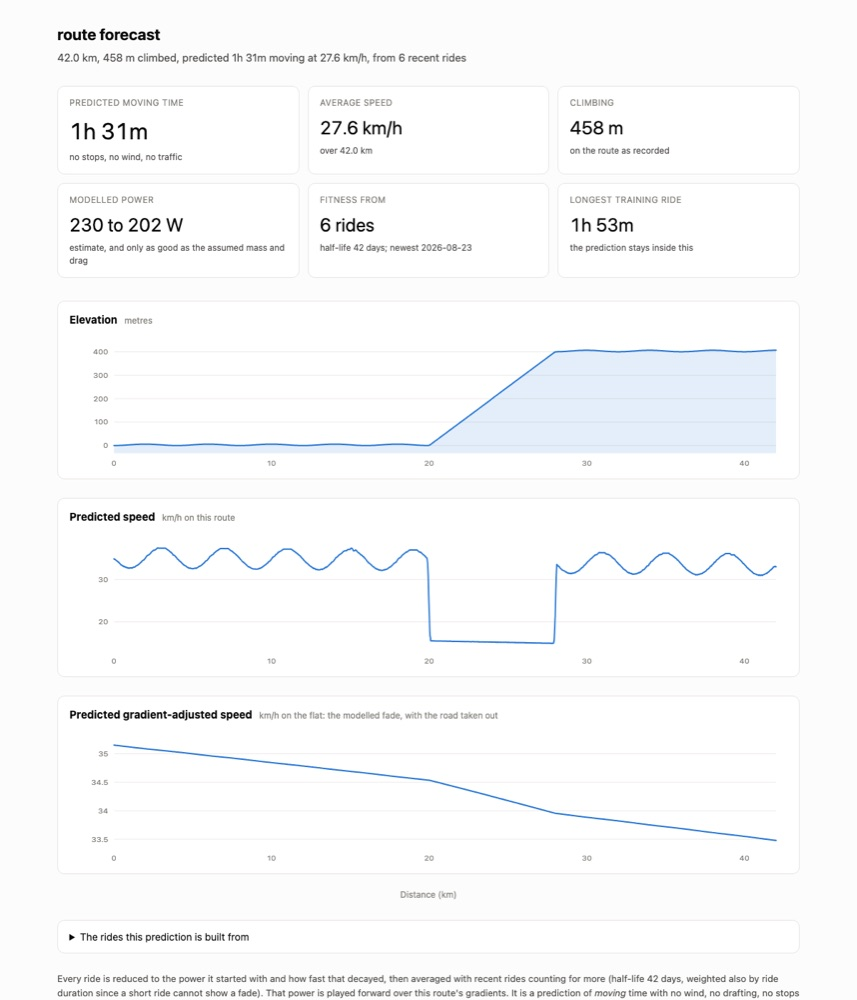

# geepeex

Tools for fetching GPX tracks and looking at them on a map. Each tool is a
subcommand of `gpx`.

| Command | What it does |
| --- | --- |
| `gpx strava` | Download matching Strava activities as GPX into `./gpx` |
| `gpx coverage` | Colour a route by whether you have ridden it in training, as a webpage |
| `gpx profile` | Elevation, speed and gradient-adjusted speed for one ride, as a webpage |
| `gpx predict` | Predict how long a route will take, from your recent rides |

## Requirements

Python 3.10 or newer, and [uv](https://docs.astral.sh/uv/). The only runtime
dependency is `requests`; the map pages pull Leaflet from a CDN when opened.

## Install

    uv sync --extra dev

Then run the CLI with `uv run gpx …`, or install it on your path with
`uv tool install .`.

## Quick start

    uv run gpx strava                                   # download some tracks
    uv run gpx coverage gpx/big-ride.gpx "gpx/*.gpx"    # see what you have ridden
    uv run gpx profile gpx/big-ride.gpx                 # see how one ride went
    uv run gpx predict route.gpx "gpx/*.gpx"            # see how long a route will take
    open coverage.html profile.html predict.html

---

## `gpx strava`

Strava has **no GPX endpoint**. The only route to a track is
`/activities/{id}/streams`, which returns parallel arrays (`latlng`,
`altitude`, `time`); geepeex reassembles those into trackpoints. The GPX is
therefore built by us, not exported by Strava, so it carries position,
elevation and timestamps but none of the sensor channels (heart rate, power,
cadence) unless we add them.

### One-time Strava app registration

1. Go to <https://www.strava.com/settings/api> and create an API application.
2. Set **Authorization Callback Domain** to `localhost`. Without this Strava
   rejects the redirect and the browser never comes back.
3. Run `gpx strava`. It prompts for the Client ID and Client Secret, opens a
   browser for consent, and stores the resulting refresh token in
   `~/.config/geepeex/strava.json` (mode 0600).

The requested scope is `activity:read_all`, so private activities are included.
Access tokens last six hours and are refreshed automatically; use
`gpx strava --reauth` to redo the browser step.

### Use

Interactive — lists the sport types actually present on the account, prompts
for keywords and types, prints the matches, then asks before downloading:

    gpx strava

Non-interactive:

    gpx strava -k commute,ferry -t Ride,VirtualRide -y
    gpx strava --after 2026-01-01 -t Run -o tracks -y

| Option | Meaning |
| --- | --- |
| `-k, --keywords` | Comma-separated name keywords |
| `-t, --types` | Comma-separated sport types, e.g. `Ride,Run` |
| `-o, --out` | Output folder (default `gpx`) |
| `--after`, `--before` | Limit to a date range, `YYYY-MM-DD` |
| `-y, --yes` | Skip the prompts and the confirmation |
| `--reauth` | Redo the browser authorisation |

Keywords are case-insensitive substrings matched against the activity **name**
only (the listing endpoint carries no description). Multiple keywords are OR;
keywords and types together are AND. A blank filter matches everything.

Files land in `./gpx` as `YYYY-MM-DD-slug-<id>.gpx`, using the *local* activity
date. Existing files are skipped, so an interrupted run resumes by re-running.

### Rate limits

Strava allows 100 requests per 15 minutes and 1000 per day. Listing costs one
request per 200 activities; each download costs one more. On a 429 the run
stops, reports how many were written, and tells you to re-run after the window
resets — already-downloaded files are skipped on the retry. Activities with no
`latlng` stream (trainer rides, pool swims) are reported and skipped rather
than written as empty tracks.

---

## `gpx coverage`

Colours a main route by whether you have ridden each part of it in training,
and writes a webpage showing it.

    gpx coverage route.gpx "gpx/*.gpx" -o coverage.html

- 🟢 **green** — ridden in the same direction as the route
- 🔵 **blue** — ridden, but only in the opposite direction
- 🟠 **orange** — never ridden
- ⬜ **light grey** — every training track, drawn underneath for context

*The example above is the synthetic route the tests use — a 2 km leg east and a
1 km leg north — not a real ride. It is there to show the four colours.*

Green wins wherever both directions were ridden: an out-and-back covers a road
twice, and the direction the route itself uses is the one worth reporting.

Training files may be given as already-expanded shell arguments or as a quoted
glob. The main route is dropped from the training set automatically, since a
glob like `gpx/*.gpx` usually contains it and would otherwise colour everything
green with nothing obviously wrong on the page.

The terminal gets the same numbers as the legend:

    Main route 3.0 km
      Ridden, same direction         1.2 km     41%
      Ridden, other direction        1.0 km     33%
      Never ridden                   0.8 km     26%

### Matching

The route is cut into segments of `--resolution` metres. A segment counts as
ridden if a training track passes within `--tolerance` metres **and** runs
within `--angle` degrees of parallel.

| Option | Default | Meaning |
| --- | --- | --- |
| `-o, --out` | `coverage.html` | Output file |
| `--tolerance` | 25 m | GPS slack when deciding a track is on the route |
| `--angle` | 45° | How far a pass may deviate and still count as the same direction |
| `--resolution` | 15 m | Metres per coloured segment |
| `--max-gap` | 200 m | Ignore training jumps longer than this |
| `--no-training-layer` | | Leave the grey tracks off the map |
| `--title` | main file name | Page title |

Three of these defaults exist to stop a plausible but wrong map, and are worth
understanding before changing them:

- **`--angle`** is what stops every road *crossing* the route from marking it as
  covered. Raise it towards 90 and junctions start counting as coverage.
- **`--max-gap`** discards the straight jump across a paused recording. Without
  it, a track that stopped on one side of town and resumed on the other paints
  coverage along every road on the line between.
- **`--resolution`** sets the colour granularity. A route recorded one point per
  200 m would otherwise be coloured in 200 m blocks whatever the tolerance.

Distances use a local equirectangular projection in metres; over the span of a
route the error is far below the GPS tolerance being worked to.

The page is Leaflet over OpenStreetMap tiles. Both layers can be toggled, and
the route always draws above the grey regardless of toggle order.

---

## `gpx profile`

Three charts against distance for a single ride: elevation, speed, and speed
adjusted for gradient — plus what that says about fading.

    gpx profile ride.gpx -o profile.html

*Again a simulated ride, not a real one — 220 W declining to 180 W over 40 km,
with a sustained climb in the last quarter. It is the fixture the tests use.*

The picture that example makes is the point of the tool. Raw speed swings
between 20 and 50 km/h with the rolling ground and collapses to 16 km/h on the
closing climb, which tells you about the road rather than the rider. The
gradient-adjusted line is a clean decline from 34.6 to 32.0 km/h: the fade that
was actually there.

### How the adjustment works

From the observed speed and the local gradient it solves for the power the
rider must have been producing:

    P = v · ( m·g·(Crr·cos θ + sin θ) + ½·ρ·CdA·v² ) / efficiency

then asks what speed that same power would give on level ground. That
flat-equivalent speed is comparable across the whole ride, so a decline in it is
a decline in the rider rather than a change in the road.

| Option | Default | Meaning |
| --- | --- | --- |
| `-o, --out` | `profile.html` | Output file |
| `--mass` | 85 kg | Rider plus bike |
| `--cda` | 0.32 m² | Drag area — road bike on the hoods |
| `--crr` | 0.005 | Rolling resistance |
| `--window` | 200 m | Span over which speed **and** gradient are measured |
| `--smoothing` | 100 m | Span the displayed elevation trace is smoothed over |
| `--points` | 1500 | Samples plotted |

### What it does and does not tell you

The absolute numbers move with the assumed mass and drag, which are guesses.
The *trend across one ride* is far less sensitive to them, which is why the
headline is a change and not a number of watts.

Coasting, braking and stopped samples are excluded from the trend, so a
descent-heavy finish is not misread as fatigue. Wind, drafting, traffic lights
and deliberate pacing are **not** accounted for and will show up as fade. A
tailwind out and a headwind back looks exactly like getting tired.

Speed and gradient are deliberately measured over the same window. Measuring
them over different spans biases the power estimate wherever speed is at a local
extreme, which put a visible spike on every descent. The gradient is a
least-squares slope over that window rather than the difference of a smoothed
elevation trace: differencing a moving average flattens off at the ends, which
read a steady 4% finishing climb as 3% and invented a fade that was not there.

---

## `gpx predict`

How long will this route take, given how you have actually been riding? Takes
the same arguments as `gpx coverage` — a route, and a glob of rides to learn
from — and produces the same three charts as `gpx profile`, except predicted
rather than measured.

    gpx predict route.gpx "gpx/*.gpx" -o predict.html

Each training ride is reduced to two numbers: the power it started at, and how
fast that power decayed as the ride went on. Those are averaged across rides
with recent ones counting for more, then played forward over the target route's
gradients, spending the modelled power against each one in turn.

| Option | Default | Meaning |
| --- | --- | --- |
| `-o, --out` | `predict.html` | Output file |
| `--half-life` | 42 days | How fast a ride's influence decays |
| `--min-minutes` | 20 | Ignore training rides shorter than this |
| `--mass`, `--cda`, `--crr` | 85 kg, 0.32, 0.005 | The same physics as `gpx profile` |
| `--window` | 200 m | Span over which speed and gradient are measured |

Recency is weighted by duration as well as by age. A twenty-minute ride cannot
show a fade, and the fade is half of what is being fitted.

### How well does it work

Well enough to be worth having, and it is measurable. The tests simulate a
rider at a known power with a known fade, generate a training history, then
predict a route the model has never seen and compare against that same rider's
actual time. For a rider whose form is steady, the prediction is exact:

| | |
| --- | --- |
| Simulated rider | 230 W start, −18 W/hour |
| Recovered from training | 230 W start, −18.1 W/hour |
| True time on the unseen route | 1h 31m |
| Predicted | 1h 31m |

**It lags a rider whose form is changing**, and by a knowable amount. Repeating
that experiment with a rider improving by 15 W a week:

| Estimator | Predicted | vs the truth of 1h 31m |
| --- | --- | --- |
| Newest ride alone | 1h 35m | +4 min, and irreducible — the newest ride is a week old |
| `--half-life 14` | 1h 42m | +11 min |
| `--half-life 42` (default) | 1h 45m | +14 min |

A weighted average of past rides can never exceed the best of them, so a rider
on an upward trend will always be predicted slower than they are. Shorten
`--half-life` if you are improving fast; the cost is that fewer rides carry the
estimate, so it gets noisier.

### What it does not know

It predicts **moving** time: no stops, no traffic lights, no cafe. It knows
nothing about wind, drafting, road surface, or how hard you decide to go on the
day. The power figures are estimates from a model whose mass and drag are
guesses, so treat them as a way of comparing routes rather than a number of
watts.

The page says so when the prediction runs past its evidence: if the route is
predicted to take longer than the longest ride it learned from, the fade beyond
that point is extrapolation and is called out as such.

---

## Tests

    uv run --extra dev pytest

The network path to Strava is not covered — tests exercise the pure logic
(filtering, GPX construction, filename derivation, coverage classification and
page rendering) against literal fixtures.

## Layout

| File | |
| --- | --- |
| `geepeex/cli.py` | The `gpx` command and its subcommands |
| `geepeex/strava.py` | OAuth, activity listing, stream fetching, filtering |
| `geepeex/gpxfile.py` | Reading and writing GPX |
| `geepeex/coverage.py` | Deciding which parts of a route were ridden, and which way |
| `geepeex/mapview.py` | Rendering a coverage result as a Leaflet page |
| `geepeex/predict.py` | Fitness from past rides, played forward over a route |
| `geepeex/charts.py` | The stacked line charts the profile and predict pages use |

`CLAUDE.md` records why things are the way they are, including the Strava
gotchas that cost time to find.
